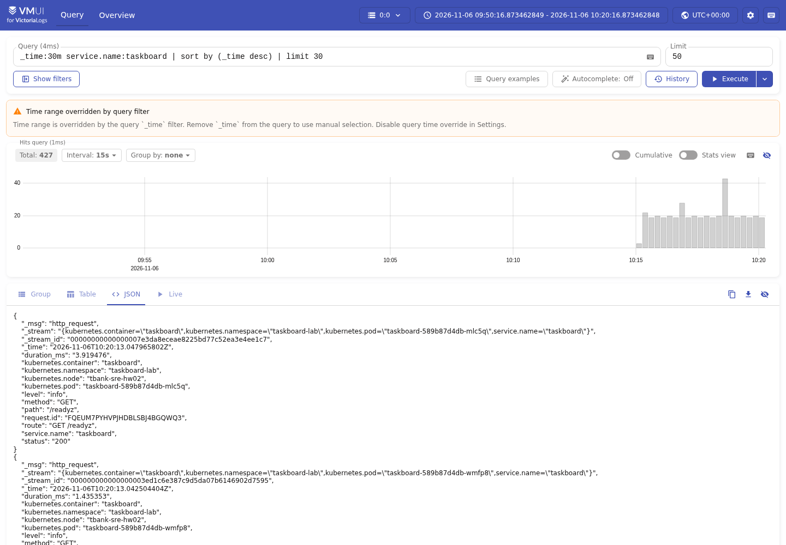
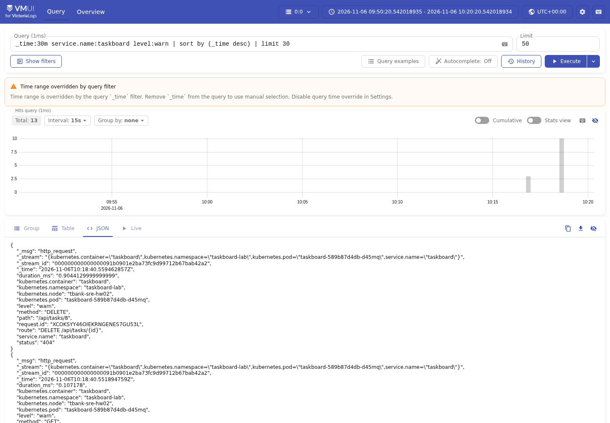
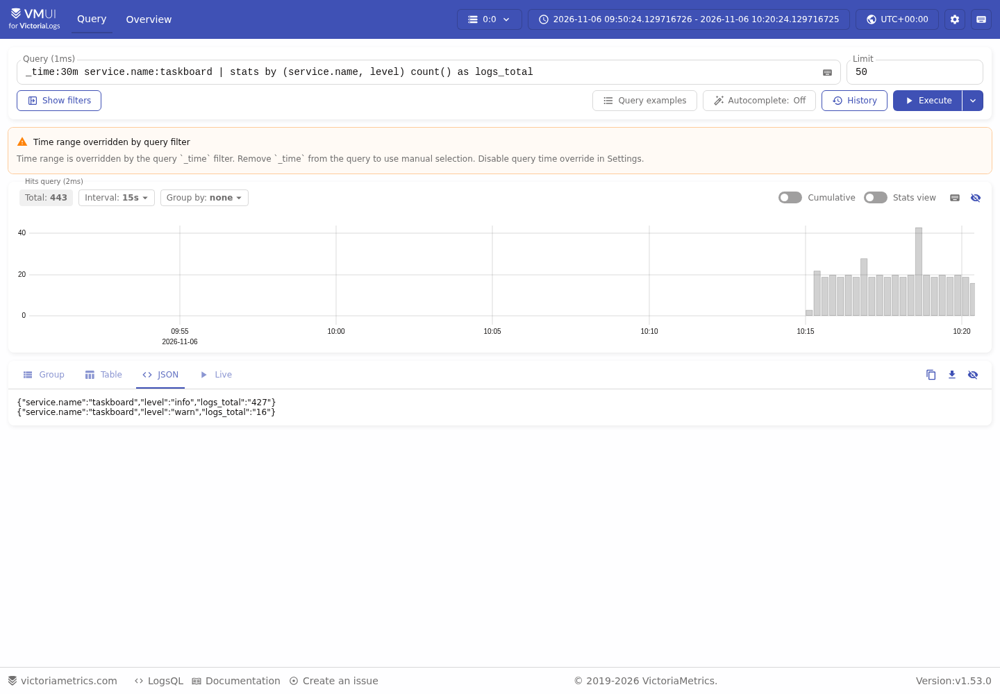
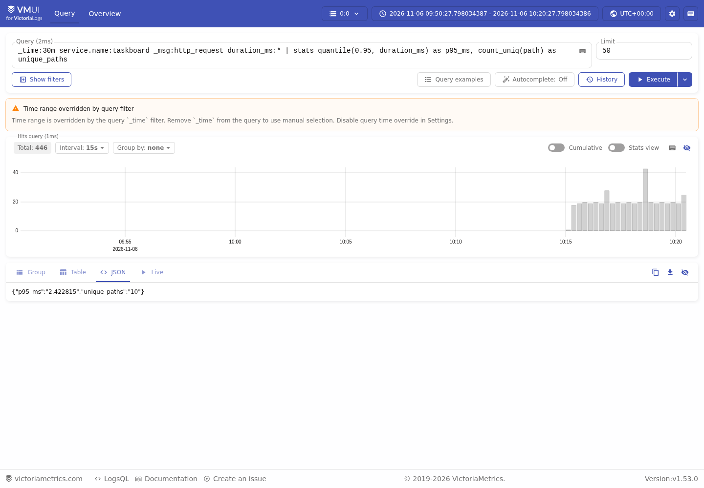

# Отчёт: домашняя работа №3 — VictoriaLogs

## Стек и развёртывание

Taskboard — трекер задач с Go REST API, простым React UI и PostgreSQL 17.6.
Использован тот же одноузловой minikube `tbank-sre-hw02` (Kubernetes 1.35.0),
где уже развёрнуты приложение и мониторинг из предыдущих домашних работ.

В namespace `logging` установлены:

- **VictoriaLogs Single v1.53.0**, официальный Helm chart
  `vm/victoria-logs-single` **0.13.11**, релиз/Service `victorialogs`;
- **Vector 0.61.0-alpine**, DaemonSet `vector-taskboard` с одним pod'ом на ноду.

VictoriaLogs работает как StatefulSet с PVC с запросом 1Gi и retention 1 день.
Service доступен внутри кластера на 9428, снаружи используется loopback
port-forward. Источники конфигурации — `deploy/logging/values.yaml`,
`vector-config.yaml`, `vector.yaml`; в архиве также есть полный Helm render.
У VictoriaLogs и Vector заданы requests/limits CPU и памяти.

Установка опирается на [официальный Helm chart](https://docs.victoriametrics.com/helm/victoria-logs-single/).
Встроенный UI этой версии находится по **`/select/vmui/`**:
[документация VictoriaLogs UI](https://docs.victoriametrics.com/victorialogs/querying/#web-ui).
Именно в нём выполнены запросы и сняты скриншоты ниже.

## Формат JSON-логов приложения

Go `log/slog` с JSONHandler пишет в **stdout** по одному JSON-объекту на строку.
Общий формат определён в `internal/logging/logger.go`, имя сервиса задаётся
через env `SERVICE_NAME` (по умолчанию taskboard), минимальный уровень — LOG_LEVEL.

| Поле | Значение |
|---|---|
| `timestamp` | Время события RFC3339Nano |
| `level` | info / warn / error |
| `message` | Имя события, например http_request, server_start, database_request_failed |
| `service.name` | taskboard |
| `request.id` | Сгенерированный приложением ID HTTP-запроса; возвращается в X-Request-ID |
| `method`, `path`, `route` | Метод, URL-путь без query и шаблон маршрута |
| `status` | Числовой HTTP-статус |
| `duration_ms` | Длительность HTTP-запроса в миллисекундах, с дробной частью |

Успешные HTTP-ответы логируются на info, 4xx — warn, 5xx — error.
Тела запросов, query-параметры, пароли, строка подключения и SQL-параметры не
логируются. Входной X-Request-ID не принимается за доверенный идентификатор:
приложение создаёт собственный. Экранирование JSON сохраняет один event на строку.
Даже ошибка конфигурации при запуске логируется через JSON-логгер.

Схема проверена unit-тестами и фактическим `kubectl logs` работающего приложения.
В stdout присутствуют именно timestamp/level/message/service.name;
после приёма VictoriaLogs использует стандартные `_time` и `_msg` для первых
и третьих полей соответственно. Числовые поля на стороне VictoriaLogs
отображаются строками, но могут участвовать в числовых stats-функциях.

## Доставка stdout → Vector → VictoriaLogs

```text
Go-приложение → stdout JSON
    ↓ Docker/CRI-файл ноды /var/log/pods/...
Vector DaemonSet: kubernetes_logs → parse_json/VRL → дисковый буфер
    ↓ Elasticsearch bulk API, gzip, HTTP внутри кластера
Service victorialogs:9428 → VictoriaLogs Single → PVC
    ↓ LogsQL
vmui через kubectl port-forward
```

Выбран DaemonSet с [источником kubernetes_logs](https://vector.dev/docs/reference/configuration/sources/kubernetes_logs/):
он отделяет доставку от приложения, позволяет приложению продолжать писать
обычный stdout и автоматически обнаруживает его pod'ы при масштабировании.
Сайдкар для каждой реплики и собственный push-клиент в Go не требуются.

Vector читает только pod'ы с `app=taskboard` в namespace `taskboard-lab`
и файлы контейнера `taskboard`. В `/var/log/pods` и `/var/lib/docker/containers`
он имеет read-only доступ; второй путь нужен для Docker-ссылок на логи.
Docker socket не монтируется. ServiceAccount/ClusterRole разрешают только
get/list/watch pods, namespaces, nodes для discovery и обогащения метаданными.
Из-за доступа к файлам ноды Vector запущен от UID 0, но без privilege escalation
и Linux capabilities, с read-only root filesystem.

VRL разбирает JSON из поля message источника, проверяет timestamp и добавляет
`kubernetes.namespace`, `kubernetes.pod`, `kubernetes.container`, `kubernetes.node`.
Ошибочные/неподходящие записи не отправляются. Логи самого Vector исключены,
поэтому цикл повторного сбора собственных событий отсутствует.

Elasticsearch-compatible bulk sink настроен по
[официальной инструкции VictoriaLogs для Vector](https://docs.victoriametrics.com/victorialogs/data-ingestion/vector/):
`/insert/elasticsearch/`, api_version v8, gzip; `timestamp` становится `_time`,
`message` — `_msg`. Stream fields — service.name и Kubernetes namespace/pod/container.
`request.id`, path и длительность остаются полями события, не stream labels.

На ноде сохраняются checkpoints и дисковый буфер Vector примерно 256MiB.
При заполнении буфера включается backpressure (`when_full: block`). Повторные
отправки и буфер снижают потери при краткой недоступности приёмника, но не дают
гарантии exactly-once: возможны повторы и потери при аварии/ротации источника.
Решение не подменяет архивирование и резервное копирование логов.

## Четыре LogsQL-запроса в vmui

Запросы также находятся в `queries.json`. На всех скриншотах видны настоящий
интерфейс vmui, текст запроса и данные, полученные от VictoriaLogs.
Для результатов выбрано JSON-представление: оно показывает все возвращённые
поля, включая агрегаты без `_time`/`_msg`. Предупреждение “Time range overridden
by query filter” означает, что временное окно задано `_time:30m` в самом запросе.

### 1. Сырые записи за последние 30 минут

```logsql
_time:30m service.name:taskboard | sort by (_time desc) | limit 30
```

Показывает 30 последних событий Taskboard без агрегации. Можно проверить
структуру JSON, время, уровень, Kubernetes pod, HTTP-статус и request.id,
а затем искать цепочку по конкретному ID. Доступные события включают health/readiness
проверки и пользовательские REST-запросы.



### 2. Фильтр по конкретному полю level

```logsql
_time:30m service.name:taskboard level:warn | sort by (_time desc) | limit 30
```

Выбирает warn-события. Для воспроизводимой демонстрации отправлены настоящие
некорректные запросы (400) и запрос чтения удалённой задачи (404); данные БД
и сервис искусственно не ломались. Этот фильтр помогает находить проблемы
клиентских вызовов. Аналогично `level:error` можно использовать для ошибок сервера.



### 3. Stats с группировкой по сервису и уровню

```logsql
_time:30m service.name:taskboard | stats by (service.name, level) count() as logs_total
```

Возвращает число событий для каждой пары service.name/level. На скриншоте
есть отдельные группы info и warn. Запрос позволяет оценить соотношение обычных
событий и предупреждений, не просматривая каждую запись.



### 4. Агрегаты quantile и count_uniq

```logsql
_time:30m service.name:taskboard _msg:http_request duration_ms:*
| stats quantile(0.95, duration_ms) as p95_ms, count_uniq(path) as unique_paths
```

Вычисляет оценку 95-го перцентиля длительности HTTP-запросов и число различных
URL-путей. Фильтр duration_ms:* исключает события без измерения длительности.
На скриншоте p95 примерно **2,42 мс**, уникальных путей **10**. Это снимок
реальной нагрузки, а не норматив: значения меняются при новых запросах.
В выборку входят также probes; для анализа только API можно добавить
дополнительный фильтр по path или route.



Синтаксис stats, quantile и count_uniq сверялся с
[документацией LogsQL](https://docs.victoriametrics.com/victorialogs/logsql/).
Все четыре запроса возвращают непустые результаты, а не только проходят парсер.

## Проверка решения

`make logging-check` выполняет CRUD, получает X-Request-ID свежего 400-ответа
и проверяет, что именно этот запрос найден в VictoriaLogs с level=warn и status=400.
Это подтверждает текущую доставку через stdout и Vector, а не наличие старых
данных или прямую запись тестового события в приёмник.

Дополнительно проверены JSON-схема и экранирование, уровни логирования,
корреляция запросов, отсутствие query-секретов в логах, Go race-тесты, CRUD,
метрики ДЗ №4, серверная валидация Kubernetes-манифестов и синтаксис CI.
Браузерный скрипт действительно нажимает Execute в vmui и сохраняет ответы
именно соответствующих запросов. В архиве есть verification.json и vmui-queries.json.

При восстановлении существующей ноды после остановки потребовалось вернуть
CRI/kubelet и внутреннюю сетевую связность; данные приложения и предыдущий
VictoriaMetrics не пересоздавались. Итоговые workloads и PVC готовы в том же
minikube. Подробности текущего окружения — в `Проверка.md`.

Бонусный Grafana-плагин/vmalert не настраивался; реализованы все основные требования.
