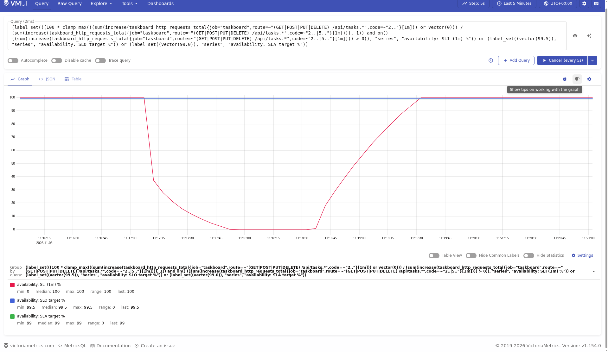
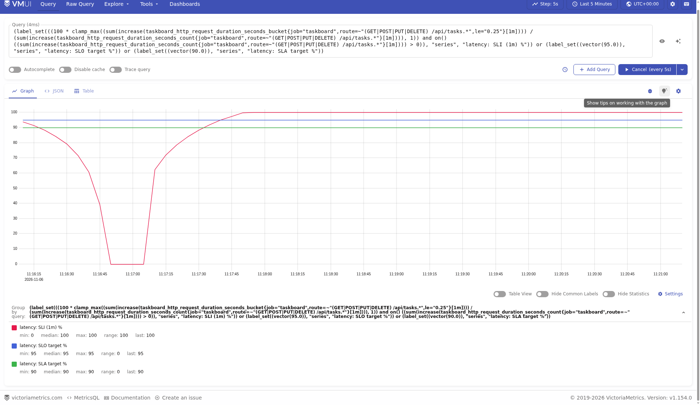
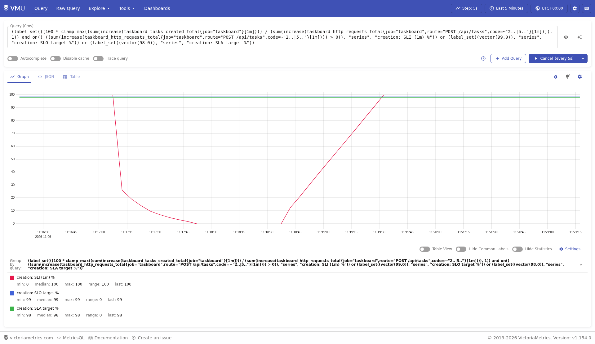
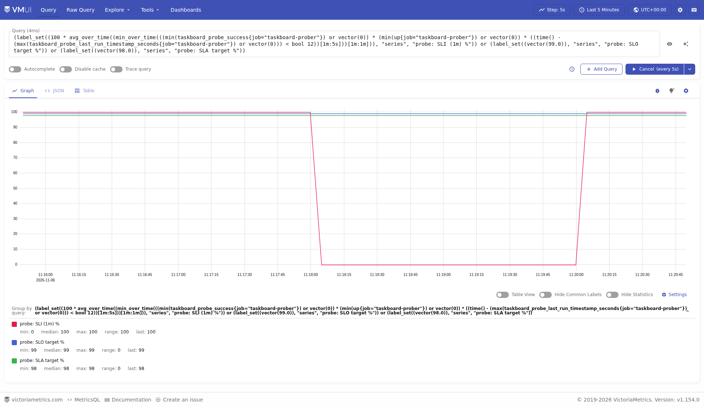
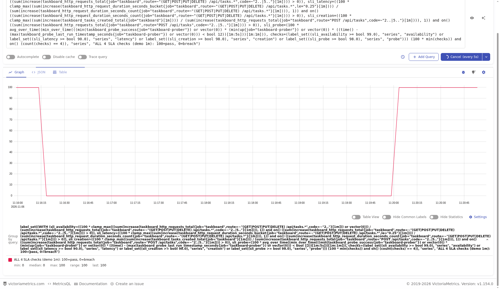

# Домашняя работа №5 — SLI, SLO и SLA Taskboard

## Метрики и область измерения

Taskboard — React UI, Go REST API и PostgreSQL в minikube `tbank-sre-hw02`.
VictoriaMetrics Single установлен официальным Helm chart **0.49.0**; scrape
каждые **5 с**, pod discovery по аннотациям `prometheus.io/*`, как в ДЗ №4.

Выбраны три семейства **уже реализованных в ДЗ №4** метрик:

| Метрика | Значение | SLI |
|---|---|---|
| `taskboard_http_requests_total{method,route,code}` | Counter завершённых HTTP-запросов с кодом и шаблоном маршрута | Успешность API и число попыток создания |
| `taskboard_http_request_duration_seconds_bucket/count` | Histogram длительности HTTP, bucket `le="0.25"` | Доля ответов не медленнее 250 мс |
| `taskboard_tasks_created_total` | Counter успешных INSERT в PostgreSQL | Успешность бизнес-операции создания |

Первые два семейства — технические, третье связывает измерение с бизнес-результатом.
Создание учитывается после SQL, HTTP-запрос — после обработчика. Суммируются
**события всех реплик**, а не проценты отдельных pod'ов. `increase` применяется
до `sum`, чтобы учесть resets при перезапуске. Статика, health/readiness и
неизвестные маршруты исключены фильтром API route.

## SLI и формулы

W — окно наблюдения; ΔW(counter) — прирост с учётом resets. Отношения умножаются
на 100%. При отсутствии запросов request SLI **не определён**, а не равен 100%.

### A: успешность API — RBSLO

**A(W) = 100 × число ответов 2xx / число ответов (2xx + 5xx).**

GET/POST/PUT/DELETE `/api/tasks` и `/api/tasks/{id}`. Клиентские 4xx исключаются.

```promql
100 * sum(increase(taskboard_http_requests_total{
  job="taskboard", route=~"(GET|POST|PUT|DELETE) /api/tasks.*", code=~"2.."
}[30d]))
/ sum(increase(taskboard_http_requests_total{
  job="taskboard", route=~"(GET|POST|PUT|DELETE) /api/tasks.*", code=~"2..|5.."
}[30d]))
```

Это серверное измерение. Запросы, не дошедшие до приложения, HTTP-counter
не видит; их дополнительно ищет пробер. Ошибки 4xx стоит анализировать отдельно:
это явное условие области SLI, а не доказательство отсутствия проблем продукта.

### L: скорость ответа API — RBSLO

**L(W) = 100 × число API-ответов ≤250 мс / число всех API-ответов.**

```promql
100 * sum(increase(taskboard_http_request_duration_seconds_bucket{
  job="taskboard", route=~"(GET|POST|PUT|DELETE) /api/tasks.*", le="0.25"
}[30d]))
/ sum(increase(taskboard_http_request_duration_seconds_count{
  job="taskboard", route=~"(GET|POST|PUT|DELETE) /api/tasks.*"
}[30d]))
```

Bucket накопительный, поэтому даёт число наблюдений ≤250 мс. Среднее от p95
реплик не используется. У исходной histogram нет label code: сюда входят
также 4xx/5xx. Быстрый 503 может улучшать L, оставаясь плохим событием A,
поэтому индикаторы оцениваются совместно.

### C: создание задачи — бизнес-RBSLO

**C(W) = 100 × число успешных INSERT / число корректных попыток создания.**
Корректные попытки — POST `/api/tasks` с ответами 2xx или 5xx; 4xx исключены.

```promql
100 * sum(increase(taskboard_tasks_created_total{job="taskboard"}[30d]))
/ sum(increase(taskboard_http_requests_total{
  job="taskboard", route="POST /api/tasks", code=~"2..|5.."
}[30d]))
```

Успешное создание возвращает 201, сбой SQL — 503. Это измерение выполнения
INSERT на сервере, а не долговечности данных или получения ответа клиентом.
Счётчики обновляются последовательно; полная формула ограничивает отношение
сверху единицей при небольшом рассогласовании момента scrape.

Полные исполняемые запросы с обработкой отсутствующего числителя и условием
`total > 0` — в `queries.json`, генератор `scripts/slo_queries.py`.
Выше показаны основные отношения без технических обёрток.

### P: UI и API через Service — TBSLO

Реализован отдельный **Go-пробер**: каждые **5 с** GET `/` и GET `/api/tasks`
через обычный Service, общий deadline **2 с**. Проверяются HTTP 200,
React root/script и JSON-массив задач с id/title/status. БД не меняется.
Это HTTP-проверка изнутри minikube, без выполнения JavaScript и внешнего Ingress.

Метрики: `taskboard_probe_success` (0/1), `taskboard_probe_duration_seconds`,
`taskboard_probe_last_run_timestamp_seconds`,
`taskboard_probe_checks_total{result="success|failure"}`. Deployment с одной
репликой и Recreate; metrics listener **9091**, без публичного Service.
Он обнаруживается тем же pod SD, что и приложение.

```text
g(t) = probe_success × up × is_fresh
is_fresh = 1, если последний завершённый check не старше 12 с, иначе 0
good_minute(k) = min g(t) за предшествующую полную минуту с шагом 5 с
P(W) = 100 × число хороших минут / число минут в W
```

Минуты привязаны к минутным границам. Неуспешный check, провал scrape или
устаревший результат делают минуту плохой; отсутствующие ряды заменяются нулём.
Исполняемый запрос: `min_over_time((g)[1m:5s])`, затем
`100 * avg_over_time((good_minute)[30d:1m])`. Неполная текущая минута не
считается здоровой заранее. После восстановления оценка меняется ступенчато,
когда появится целиком здоровая минута; это занимает до двух минут.
Короткий сбой между двумя проверками может остаться незамеченным.

## SLO и SLA

Окно SLO и SLA — **скользящие 30 суток**: 2 592 000 секунд / 43 200 минут.
Это выбранные учебные цели; внутренние SLO строже внешних обещаний.

| Индикатор | SLO за 30d | SLA за 30d |
|---|---:|---:|
| A: успешность API | ≥99,5% | ≥99% |
| L: API-ответы ≤250 мс | ≥95% | ≥90% |
| C: успешное создание | ≥99% | ≥98% |
| P: хорошие минуты пробера | ≥99% | ≥98% |

**SLA:** команда Taskboard обещает пользователю эти четыре показателя при работе
с корректными запросами через HTTP Service. Плановые работы включаются в расчёт.
При нарушении команда уведомляет пользователя, приостанавливает функциональные
релизы до восстановления и предоставляет разбор причин и план исправлений
в течение двух рабочих дней. Это формулировка соглашения для учебного приложения,
а не утверждение о существующем подписанном договоре с клиентом.

**SLA_pass(W) = A≥99 AND L≥90 AND C≥98 AND P≥98** при полном окне наблюдений.
Если request SLI отсутствует, общий статус неопределён. Проценты не перемножаются:
такой расчёт потребовал бы дополнительных предположений.

Бюджет request-ошибок: **(1−target) × N(W)**. Для API SLO это 0,005N плохих
запросов, для создания — 0,01N, для latency — 0,05N медленных событий.
Остаток — допустимые плохие события минус фактические. TBSLO допускает
**432 плохие минуты** по SLO 99% и **864 минуты** по SLA 98%.
Request-бюджет нельзя переводить в минуты без предположений о трафике.

Retention увеличен с 1d до **35d**, отдельным Helm values, с сохранением PVC.
Полного месяца наблюдений на момент записи нет. Увеличение retention не
возвращает уже удалённую историю; при длительной работе нужно контролировать
место учебного PVC 1Gi. Демонстрация не подтверждает соблюдение месячного SLA.
Запрос `monthly_window_ready` проверяет наличие начала наблюдений не позднее
30 суток назад; до этого формальный `monthly_sla_compliance` не возвращает оценку.
Пробелы внутри начавшегося периода TBSLO оценивает консервативно как плохие.
Для вложенного запроса 30d/1m/5s Helm values задаёт
`search.maxPointsSubqueryPerTimeseries=600000`: требуется около 518600 точек,
что больше стандартного лимита 100000. Проверен и полный запрос 30d, не только demo.

## Изменения для скринкаста

Схема БД, REST CRUD и React UI сохранены. Добавлены Go-пробер, временный Job
реальной CRUD-нагрузки и настройки API `DEMO_LATENCY` / `DEMO_FAILURE_EVERY`.
Они выключены по умолчанию, управляются только env в Deployment.
Публичного endpoint управления нет. Metrics, health и readiness не затрагиваются.

Генератор читает список, создаёт тестовую задачу, удаляет только созданный им ID
с повтором при 503. При аварии может остаться задача `SLO demo: temporary task`;
ошибка очистки логируется. Нагрузочный Job ограничен 30 минутами.

| Фаза | Реальное изменение | Что видно на графиках |
|---|---|---|
| Healthy | Задержки и отказы выключены | SLI около 100%, общий статус 100 |
| Slow | `DEMO_LATENCY=750ms` | L падает ниже 95/90; A/C остаются высокими; статус 0 |
| Errors | `DEMO_FAILURE_EVERY=1`, задержка 0 | API возвращает 503 до SQL; A/C падают, P получает плохие минуты; быстрые 503 улучшают L |
| Recovery | Обе настройки 0 | Request SLI восстанавливаются после выхода инцидента из окна; P — после здоровой минуты; статус возвращается к 100 |

В видео показаны реальные команды `kubectl`/`make` в xterm и настоящая vmui
в Chromium с auto-refresh **5 с**. Использовано **демонстрационное окно 1m**,
чтобы короткий инцидент был виден. SLO/SLA — постоянные целевые линии; меняются
измеренные SLI и статус выполнения условий на коротком окне. Этот статус
не заменяет месячный `SLA_pass(30d)`.

`kubectl set env` вызывает rolling update; переходы и resets входят в данные.
Наблюдения не импортируются вручную в TSDB. X11 захвачен ffmpeg без ускорения.
После записи возвращён healthy, нагрузочный Job остановлен; пробер остаётся.

## Графики из vmui











## Проверка

Unit/race-тесты проверяют JSON и timeout пробера, HTML/JSON-схему, OpenMetrics,
валидность env, частоту ошибок, отмену задержки и учёт 503 в правильном route
без увеличения бизнес-счётчика. Проверены fmt/vet, React build, server-side
dry run манифестов, сбор пробера и изменение реальных SLI по четырём фазам.

В архиве: `screencast.mp4`, PNG, исходники/манифесты, полный Helm render,
`queries.json`, JSON проверок фаз и `vmui-recording.json` с ответами браузерных
запросов. Подробности выполнения — `Проверка.md`, воспроизведение — `README.md`.
Пароли и локальный kubeconfig исключены.

Основа: [термины Google SRE](https://sre.google/sre-book/service-level-objectives/),
[гистограммы Prometheus](https://prometheus.io/docs/practices/histograms/),
[MetricsQL increase/rollup/subquery](https://docs.victoriametrics.com/metricsql/),
[vmui VictoriaMetrics](https://docs.victoriametrics.com/victoriametrics/single-server-victoriametrics/#vmui).
