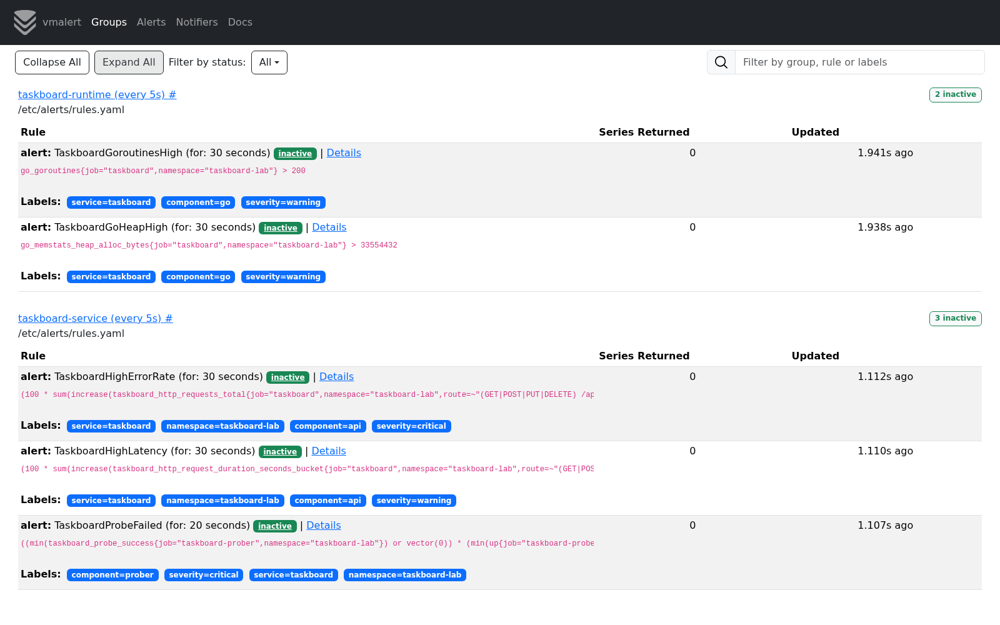
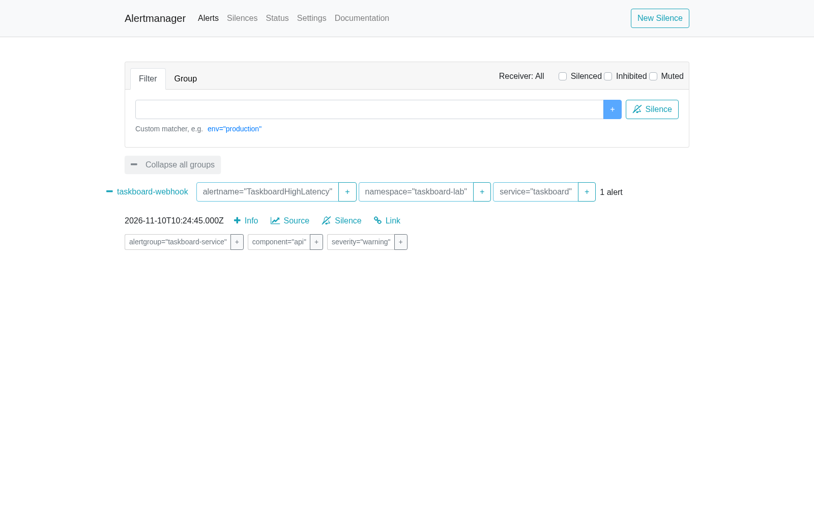
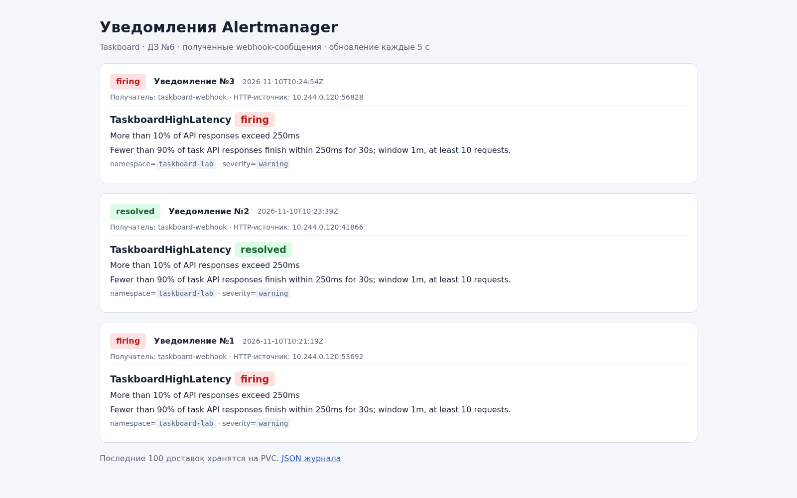
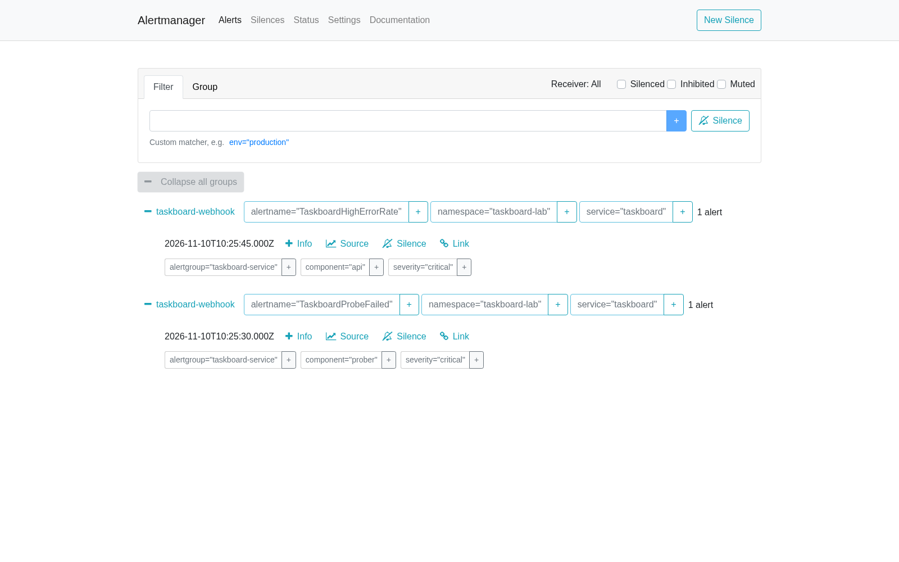
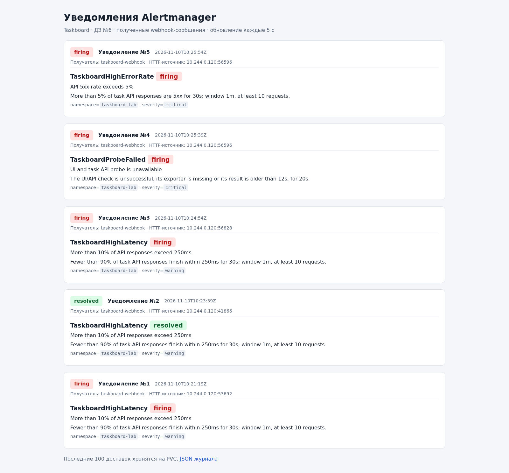
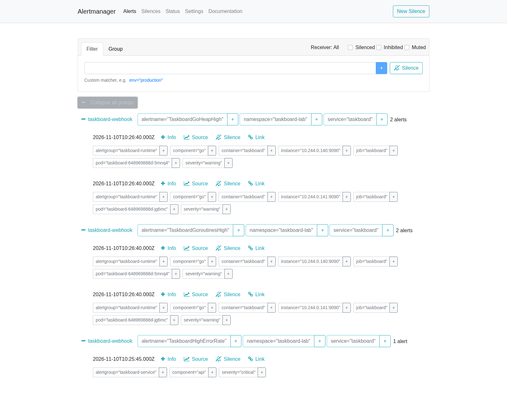
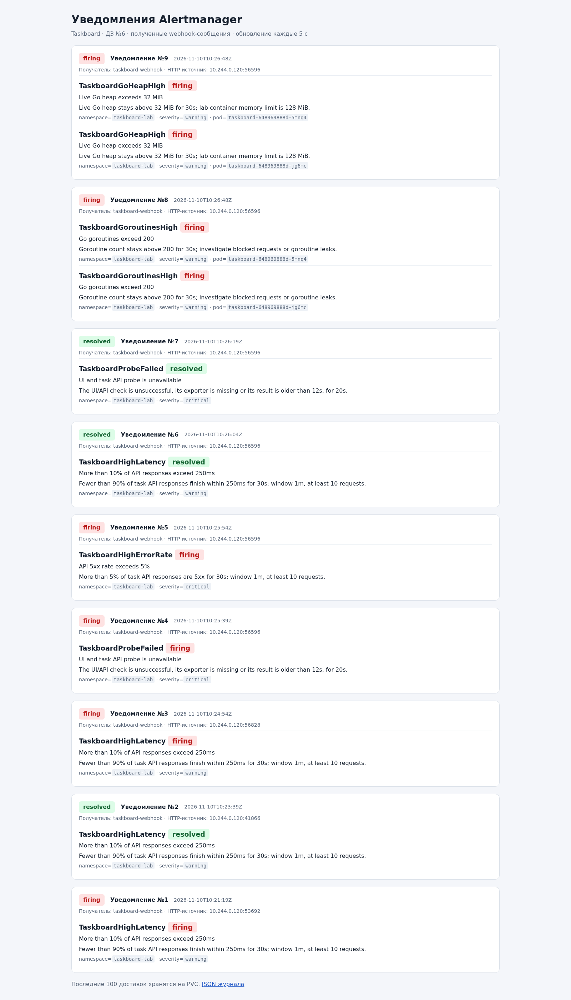
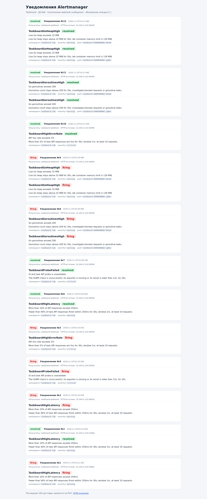

# ДЗ №6. Алерты Taskboard

Taskboard — Go/React-приложение с PostgreSQL. Метрики собирает VictoriaMetrics.
vmalert 1.154.0 проверяет правила каждые 5 секунд и отправляет события в
Alertmanager 0.35.0. Тот группирует их и доставляет HTTP webhook в `alert-inbox`.
Приёмник сохраняет последние 100 уведомлений на PVC и показывает их в браузере.

## Условия

| Алерт | Условие | Зачем |
|---|---|---|
| TaskboardHighErrorRate | Более 5% ответов API — 5xx за 1 минуту, 30 секунд подряд | Видеть массовые ошибки операций |
| TaskboardHighLatency | Менее 90% ответов API укладываются в 250 мс за 1 минуту, 30 секунд подряд | Замечать задержки при успешных ответах |
| TaskboardProbeFailed | UI/API-проба неуспешна, отсутствует или старше 12 секунд; условие держится 20 секунд | Проверять доступность с точки зрения клиента |
| TaskboardGoroutinesHigh | Более 200 goroutines в одном pod, 30 секунд подряд | Возможная утечка или блокировка запросов |
| TaskboardGoHeapHigh | Heap одного Go-процесса больше 32 MiB, 30 секунд подряд | Рост памяти до достижения лимита контейнера 128 MiB |

Для первых двух правил нужно минимум 10 запросов за минуту. Сбросы счётчиков
обрабатываются `increase` до суммирования реплик. Правила ограничены `taskboard-lab`.
Два последних используют стандартные `go_goroutines` и `go_memstats_heap_alloc_bytes`
из `prometheus/client_golang` — это метрики рантайма Go, аналогичные метрикам actuator.
Пороги и короткие окна выбраны для учебного стенда.

## Уведомления

Ошибки и недоступность имеют severity `critical`, задержки и Go — `warning`.
Группировка: `alertname`, `namespace`, `service`; первая отправка через 5 секунд,
обновления группы раз в 10 секунд, повтор нерешённого алерта раз в час.
`send_resolved: true` доставляет сообщение о восстановлении.

Уведомления приходят в локальный webhook-приёмник внутри Kubernetes. Внешний чат
не подключён. Скриншоты приёмника показывают сохранённые HTTP-сообщения Alertmanager
с временем получения и адресом отправителя. Все интерфейсы снаружи доступны
через loopback port-forward.

## Проверка

Для проверки используется временный Job с CRUD-нагрузкой. `DEMO_LATENCY=750ms`
вызывает задержки, `DEMO_FAILURE_EVERY=1` — HTTP 503. `DEMO_GOROUTINES=300` и
`DEMO_HEAP_MIB=48` создают настоящие goroutines и удерживают выделенную память;
значения метрик не подменяются. По умолчанию эти режимы выключены.

Проверка 10 ноября 2026 года: все пять алертов дали firing-уведомления и затем
resolved. Go collector показал рост с 13 до 315 goroutines и heap до 53,4 MiB.
После восстановления — 13 goroutines и 2,1 MiB heap; DEMO-флаги обнулены,
нагрузочный Job удалён. Состояния правил и полученные webhook сохранены в `verification/` архива.

Конфиги: [правила](../../deploy/alerting/rules.yaml),
[Alertmanager](../../deploy/alerting/alertmanager.yml),
[манифесты](../../deploy/alerting). Команды запуска — в [README](README.md).
Дополнительно правила проверяются `vmalert-tool`: пустой и малый трафик, сбросы
счётчиков, короткий всплеск, пропажа пробера, пороги и восстановление.

### Правила в vmalert

### Задержки

### Ошибки API и пробера

### Рантайм Go

### Восстановление

Использована документация [vmalert](https://docs.victoriametrics.com/victoriametrics/vmalert/)
и [Alertmanager webhook](https://prometheus.io/docs/alerting/latest/configuration/#webhook_config).
