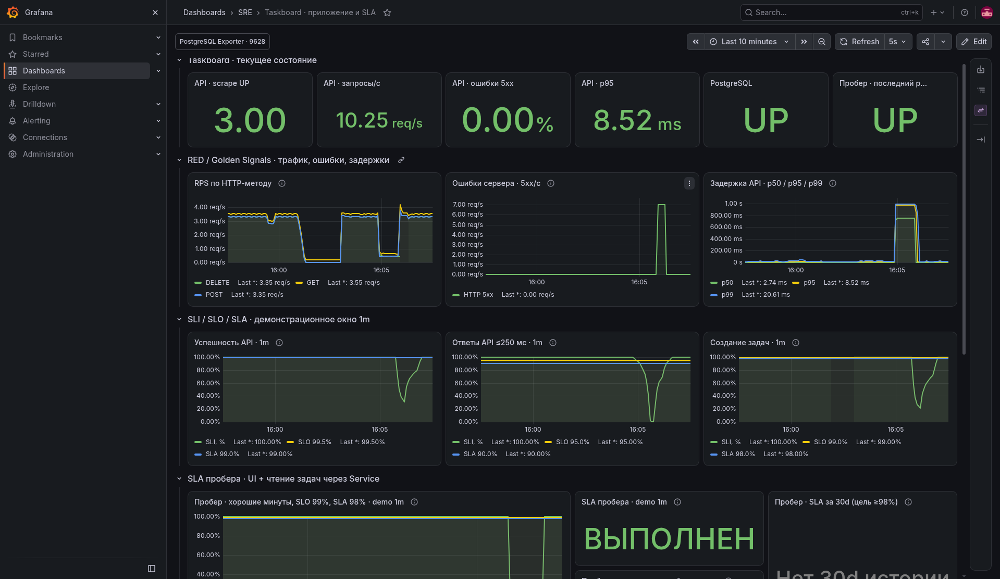
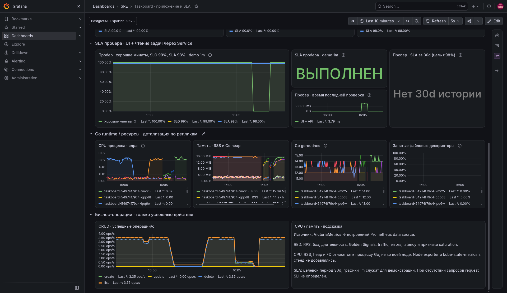
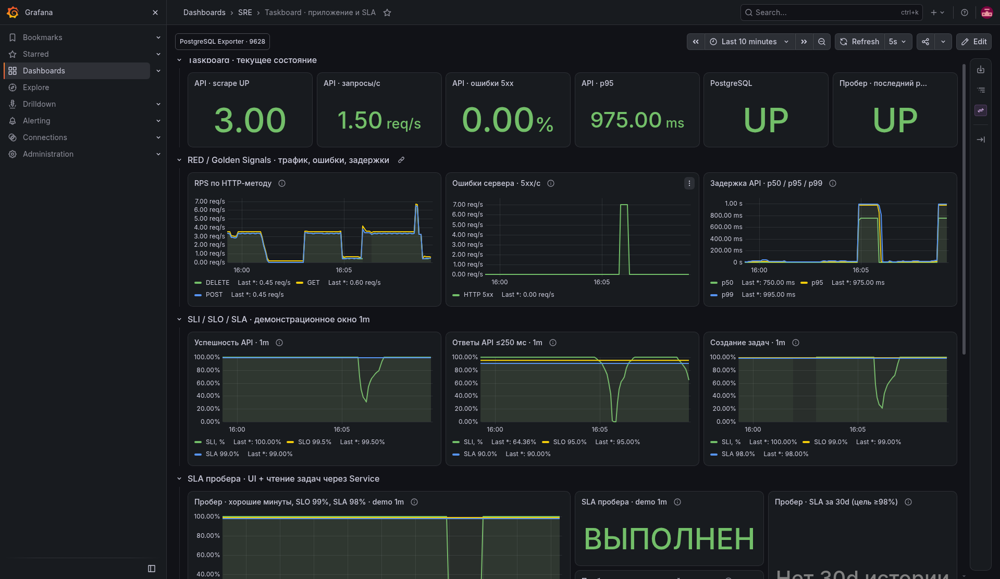
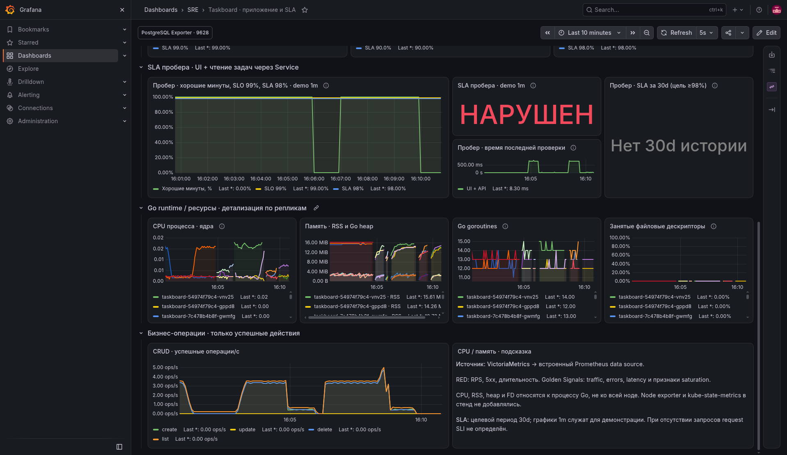
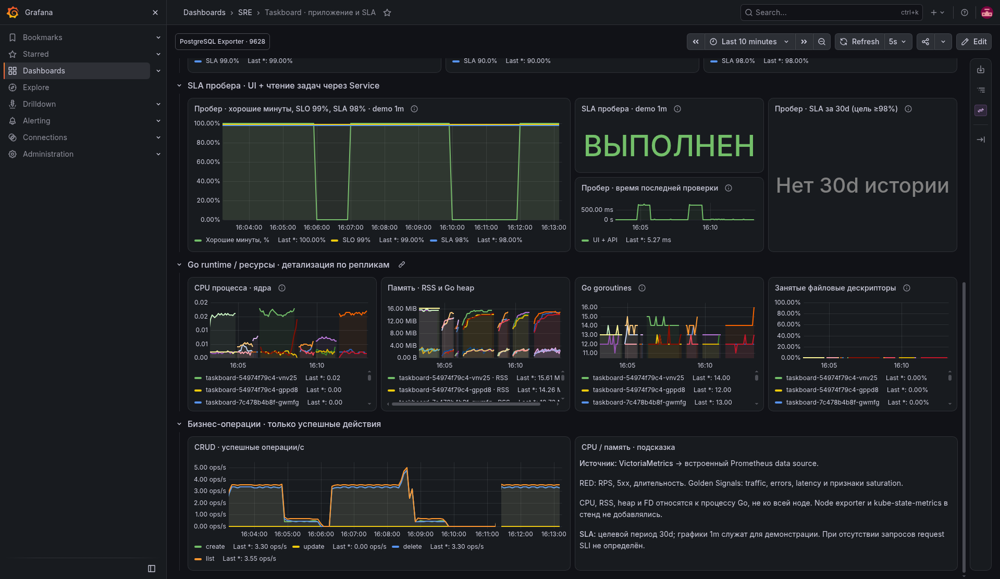
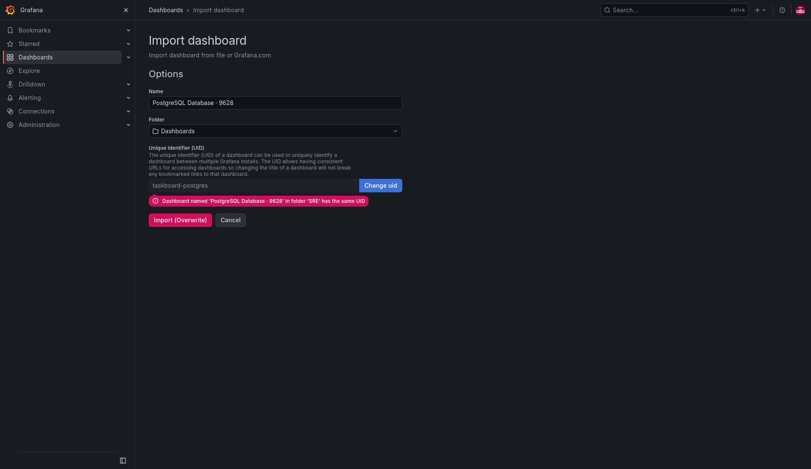
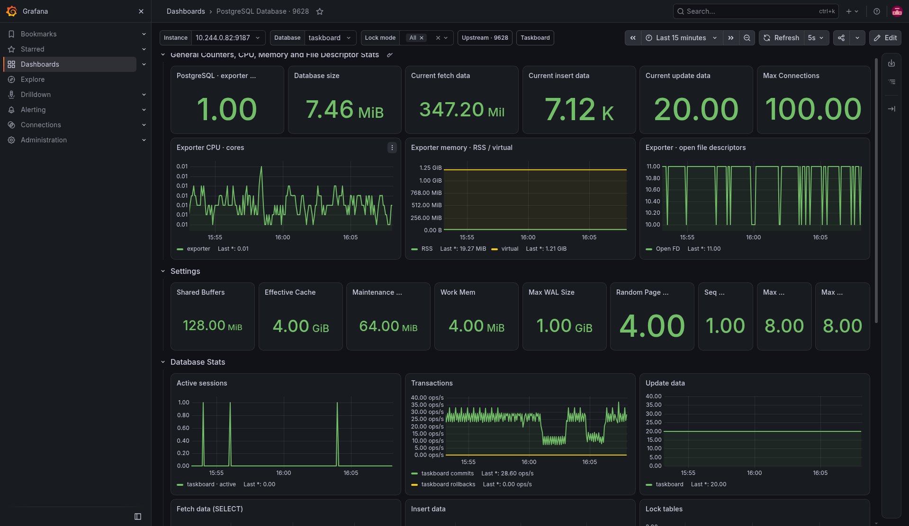
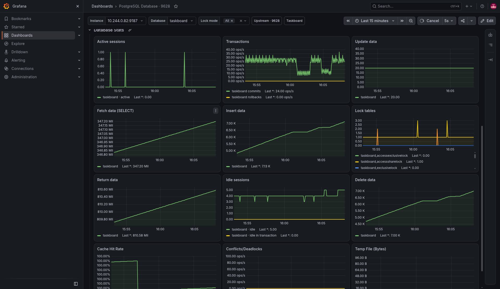

# ДЗ №7. Grafana

Приложение — Taskboard (Go, React, PostgreSQL 17). Grafana **13.3.0** установлена
в minikube `tbank-sre-hw02`, namespace `monitoring`, чартом
**grafana-community/grafana 14.4.0**. SQLite Grafana и импортированные дашборды сохраняются на PVC 1 GiB.
Снаружи используется `kubectl port-forward`; пароль администратора — в Secret.

Источник обоих дашбордов — VictoriaMetrics Single из ДЗ №4, встроенный Prometheus
data source с UID `victoriametrics`. Grafana обращается к
`http://vm-single.monitoring.svc.cluster.local:8428`. Метрики Go/API, пробера и
sidecar PostgreSQL exporter уже собираются VictoriaMetrics через pod discovery.
Браузер обращается к Grafana, а не к внутренним портам экспортёров.

## Панели приложения

| Панели | Метрики и назначение |
|---|---|
| API scrape UP, PostgreSQL, результат пробера | `up`, `pg_up`, `taskboard_probe_success` и свежесть проверки: доступность сборщиков и пользовательского пути |
| RPS и 5xx | `rate(taskboard_http_requests_total)` по методам и кодам: traffic/errors из RED и Golden Signals |
| p50/p95/p99 | `histogram_quantile` по сумме `rate(..._bucket)` всех реплик: задержки без усреднения перцентилей |
| Три request SLI с целями | успешность API, доля ответов ≤250 мс, успешное создание задач: формулы из ДЗ №5 |
| CPU, RSS, Go heap, goroutines, FD | `process_cpu_seconds_total`, `process_resident_memory_bytes`, `go_memstats_heap_alloc_bytes`, `go_goroutines`, `process_open_fds / process_max_fds`: ресурсы и признаки насыщения |
| Успешные CRUD-операции | `taskboard_tasks_*_total`, `taskboard_task_lists_viewed_total`: бизнес-нагрузка |

Counter сначала обрабатывается `rate`/`increase` для каждой реплики, затем
суммируется; сброс при рестарте не превращается в отрицательный RPS. Memory — gauge.
Из API-графиков исключены `/healthz`, `/readyz` и выдача UI. Нулевой request
denominator даёт отсутствие оценки. Полного USE хоста без node exporter здесь нет;
FD показывает насыщение конкретного процесса, goroutines — косвенный признак.

## SLA пробера

Пробер каждые 5 с читает UI и список задач через Service, не меняя БД.
Он проверяет HTML/JSON, без исполнения React в браузере.
Хорошая минута — минута, в которой все проверки успешны, scrape доступен,
последний результат не старше 12 с. `SLI = 100 × хорошие минуты / все минуты`.
Цели из ДЗ №5: SLO **99%**, SLA **98%** за **30d**.

На отдельном графике показаны SLI и линии SLO/SLA. Рядом — бинарное выполнение
порога на demo-окне **1m** и отдельная месячная оценка. До накопления 30 суток
месячная панель показывает «Нет 30d истории». Значение 100% на коротком окне
не объявляется выполнением месячного SLA. Формулы берутся из `scripts/slo_queries.py`.

Режим задержки 750 мс снижает latency SLI. При HTTP 503 растёт доля ошибок,
пробер фиксирует плохие минуты, demo-SLA нарушается. После `MODE=healthy`
индикаторы восстанавливаются; целевые линии остаются постоянными.

## PostgreSQL Exporter

Импортирован [готовый дашборд №9628](https://grafana.com/grafana/dashboards/9628-postgresql-database/).
В видео JSON загружается через штатный Import Grafana. Оригинальный JSON и SHA256
сохранены в `deploy/grafana`; он адаптирован к нашим labels и текущей Grafana:
старые graph/singlestat заменены на timeseries/stat, переменные instance/database
используют метрики exporter; счётчики строк отображаются в штуках, а не в байтах.
Панели отсутствующих postmaster/checkpoint-метрик
удалены или заменены размером БД; CPU/RSS явно подписаны как ресурсы exporter.
Показаны соединение, размер БД, настройки, транзакции, активные/idle-сессии,
SELECT/INSERT/UPDATE/DELETE, cache hit, locks, deadlocks и временные файлы.

## Проверка и артефакты

Экспорт из работающей Grafana: `dashboards/taskboard.json`, `dashboards/postgres.json`.
В архиве также исходники, Helm values/render, отчёт, PNG и `screencast.mp4`.
Проверка `make grafana-check` выполняет 68 настоящих запросов через Grafana и
проверяет свежесть метрик; допустимо пустой остаётся месячная оценка без 30d истории.
На записи показаны healthy/slow/errors/recovery и импорт PostgreSQL.
После демонстрации задержки/ошибки выключены, временный CRUD Job удалён.

Запись — **6:28**, настоящий экран Chromium/xterm без ускорения.
Сохранены 1112 успешных ответов data source в браузере. Проверены `make check`,
Compose + CRUD, server dry run манифестов и свежесть данных VictoriaMetrics.

| Фаза | Успех API, % | Ответы ≤250 мс, % | Создание, % | Хорошие минуты пробера, % |
|---|---:|---:|---:|---:|
| healthy | 100 | 100 | 100 | 100 |
| slow | 100 | 48.98 | 100 | 100 |
| errors | 0 | 100 | 0 | 0 |
| recovery | 100 | 100 | 100 | 100 |

Быстрые 503 сохраняют latency SLI: успешность и пробер показывают отказ отдельно.

Использованы [инструкция Helm](https://grafana.com/docs/grafana/latest/setup-grafana/installation/helm/),
[provisioning Grafana](https://grafana.com/docs/grafana/latest/administration/provisioning/)
и [интеграция VictoriaMetrics](https://docs.victoriametrics.com/victoriametrics/integrations/grafana/).
